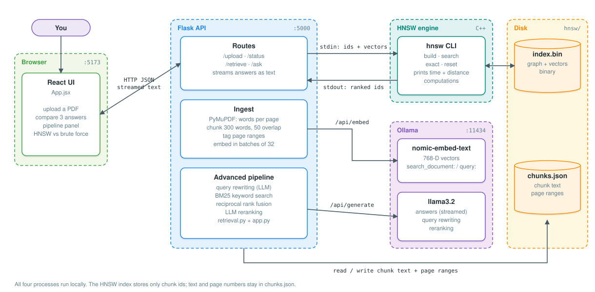
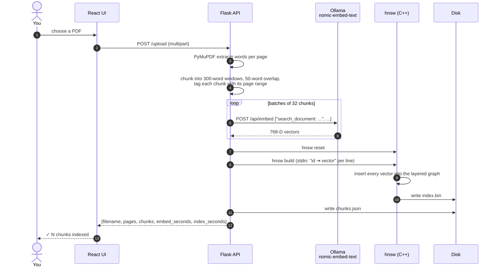
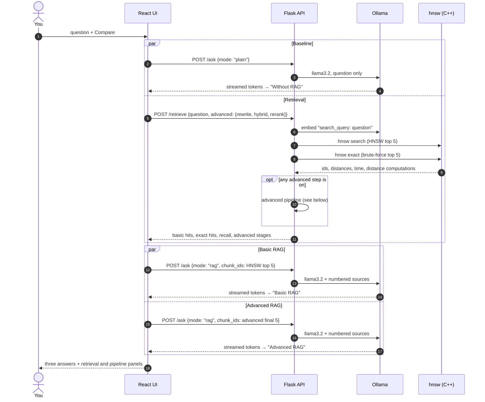
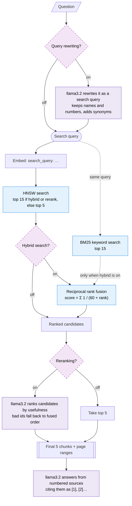
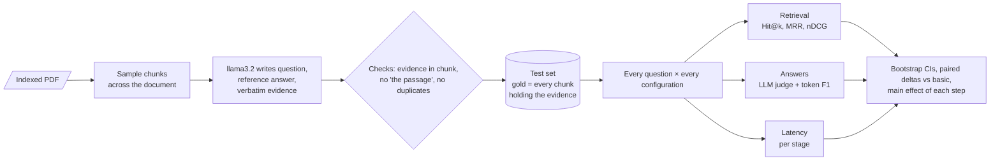
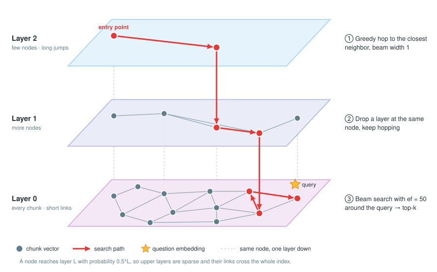
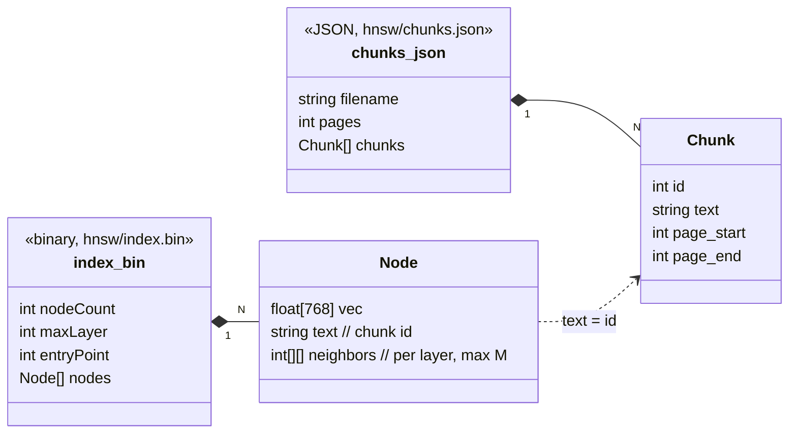

# Local Document Q&A Engine

> Ask questions about any PDF — fully local, zero data leaves your machine.
> Every question is answered three ways (no RAG, basic RAG, advanced RAG) so you can see what retrieval adds.

Built with a custom HNSW vector index in C++, Ollama for local LLM inference, Flask REST API, and a React frontend.

---

## Contents

- [What it does](#how-rag-works-here), [agentic RAG](#agentic-rag)
- [Architecture](#architecture)
- [Data flow](#data-flow): [indexing](#1-indexing-a-pdf), [asking](#2-asking-a-question-compare), [advanced pipeline](#3-advanced-retrieval-pipeline)
- [Evaluation](#evaluation): measure what each step is worth
- [How HNSW search works](#how-hnsw-search-works)
- [Data model](#data-model) and [API](#api)
- [Setup](#setup)

---

## How RAG Works Here

1. PDF is split into overlapping 300-word chunks
2. Each chunk is embedded into a 768D vector using `nomic-embed-text`
3. Vectors are inserted into the HNSW index
4. At query time, the question is embedded and HNSW finds the 5 closest chunks
5. Those chunks become numbered sources for `llama3.2`, which streams an answer citing them
6. In parallel, the same model answers the same question with no document, as the baseline

The model never sees the full document — only the most relevant chunks. This keeps answers accurate and fast.

## RAG vs no RAG

Click **Compare** and the page shows:

- **Without RAG**: llama3.2 on its own. For anything specific to your PDF it will guess or refuse.
- **Basic RAG**: llama3.2 given the top 5 HNSW chunks, citing them as [1], [2]...
- **Advanced RAG**: the same model after query rewriting, hybrid search and reranking, each with its own switch
- **Pipeline panel**: what each advanced step retrieved and which chunks differ from basic RAG
- **Retrieval panel**: the chunks used, with page numbers and similarity, plus HNSW vs brute-force search time,
  distance computations, and how many of HNSW's results match the exact top 5

Ask questions only your document can answer (names, numbers, definitions) to see the difference most clearly.

---

## Agentic RAG

The fourth answer comes from an agent that decides how to answer instead of running one fixed pipeline
(`backend/agent.py`, `POST /agent`). Every decision streams to the **Agent trace** panel as it happens.

1. **Route.** The model sorts the question into one of four routes:
   - `direct`: small talk or general knowledge, answered without retrieval
   - `lookup`: one fact, answered from a single hybrid search (the fast path)
   - `research`: several facts, comparisons, or reasoning across sections, handled by the tool loop
   - `summary`: an overview, done as a map-reduce over chunks spread through the document
   If the model's reply can't be parsed, simple keyword rules pick the route.
2. **Tool loop** (`research`). The agent picks one tool per step until it has evidence for every part of the
   question, or until it hits 4 steps:
   - `search`: hybrid HNSW and BM25 search
   - `keyword`: BM25 search for exact names and numbers
   - `read_neighbors`: reads the chunks before and after a hit
   - `read_page`: reads every chunk on a page
   Evidence from all the calls is merged by reciprocal rank fusion, and the best 6 chunks become the sources.
3. **Self-check.** The answer is split into claims, and each claim is checked against the sources it cites.
   Citations to sources that don't exist are flagged too.
4. **Correction.** When a claim isn't supported, the agent searches for that claim, rewrites the answer once, and
   checks it again. If a `lookup` answer refuses or fails the check, the question moves up to `research`.

The agent is also a configuration in the evaluation harness (**Agentic RAG**), so it is scored on the same
test set as the fixed pipelines. It adds two latency stages (`plan` and `self-check`) and a
**Passed self-check** metric.

### Model providers

`LLM_PROVIDER=ollama` (the default) keeps everything local. `LLM_PROVIDER=openai` switches to any API
that speaks the OpenAI format (OpenAI, Groq, Together, vLLM, LM Studio), configured with `OPENAI_BASE_URL`,
`OPENAI_API_KEY`, `LLM_MODEL` and `EMBED_MODEL`. Changing the embedding model means re-uploading the PDF.

---

## Architecture

Everything runs on your machine as four local processes. Nothing is sent to a cloud service.

<p align="center">
  
</p>

| Component | Tech | Responsibility |
|---|---|---|
| React UI | React 19, Vite | Upload a PDF, ask a question, stream three answers, show retrieval stats |
| Flask API | Python, Flask, PyMuPDF | Extract and chunk text, call Ollama, drive the HNSW binary, run the advanced pipeline |
| HNSW engine | C++17, from scratch | Approximate nearest-neighbor search over chunk vectors, plus exact search for comparison |
| Ollama | nomic-embed-text, llama3.2 | Turn text into vectors, generate answers, rewrite queries, rerank passages |
| Storage | `index.bin`, `chunks.json` | The graph and vectors (binary), and chunk text with page ranges (JSON) |

The HNSW index stores only chunk ids. Text and page numbers live in `chunks.json`, so non-ASCII text
never passes through command-line arguments.

---

## Data flow

### 1. Indexing a PDF



### 2. Asking a question (Compare)

One click starts three answers. The no-RAG baseline starts at once; the two RAG answers start when retrieval finishes.



### 3. Advanced retrieval pipeline

Each dashed box is a switch in the UI. With all three off, advanced RAG is identical to basic RAG.



| Step | What it does | Why it helps |
|---|---|---|
| Query rewriting | llama3.2 turns the question into a search query with key terms and synonyms | Conversational questions ("what did they decide?") embed poorly |
| Hybrid search | BM25 keyword search runs next to HNSW; results are merged with reciprocal rank fusion | Embeddings blur exact terms like names, codes and numbers; keywords catch them |
| Reranking | llama3.2 reorders the top 15 candidates by usefulness and keeps 5 | Similar text isn't always useful text; the LLM can judge which passage answers the question |

---

## Evaluation

The **Evaluate** tab (or `backend/evaluate.py` from a terminal) measures what each part of the pipeline is worth
on your PDF, instead of judging from a handful of questions.



**Configurations.** No RAG, basic RAG (HNSW top 5), exact brute-force search (shows what HNSW's approximation
costs), and all 7 on/off combinations of rewriting, hybrid search and reranking. Because the full 2×2×2 grid runs,
the effect of each step is measured with the other steps both on and off.

| Group | Metric | Meaning |
|---|---|---|
| Retrieval | Hit@1, Hit@3, Hit@5 | A chunk containing the evidence is in the top k |
| | Recall@5 | Share of the evidence chunks retrieved (overlapping chunks can both hold it) |
| | MRR@5, nDCG@5 | How high the first evidence chunk ranks |
| | Hit@15 (candidates) | Evidence was in the pool the reranker chose from: the ceiling for reranking |
| Answers | Correctness, relevance | LLM judge compares the answer with the reference answer (1–5, shown as 0–1) |
| | Faithfulness | LLM judge checks every claim against the sources the model was given |
| | Token F1, refusal rate, citations | Cheap checks that need no judge |
| Latency | p50, p95, per stage | embed, rewrite, search, rerank, generate |

**Statistics.** Every mean has a 95% bootstrap interval. Differences from basic RAG are paired over the same
questions, with a bootstrap p-value. "What each step adds" averages, per question, the change across every pair of
configurations that differ only in that step.

**Cost.** A full run with the judge makes about 30 LLM calls per question. Temperature 0 calls are cached, so
configurations that retrieve the same chunks share one answer; cached results report the latency of the original
call. Expect tens of minutes for 25 questions on a laptop. Untick the judge or pick fewer configurations for a
quick pass.

**Caveats.** The questions are written by the same model from the document's own wording, which favours keyword
search, and a model grading its own answers is lenient. Review the generated questions (you can delete bad ones),
and set `JUDGE_MODEL` to a larger model (for example `llama3.1:8b`) for stricter grading.

```bash
cd backend
python evaluate.py generate --n 40              # test set from the indexed PDF
python evaluate.py run --out report.md          # everything, with the judge
python evaluate.py run --configs basic hybrid advanced --no-judge --limit 10
```

Test sets and runs are saved in `hnsw/eval/` and appear in the Evaluate tab. Each run can be downloaded as JSON or
as a Markdown report.

---

## How HNSW search works

HNSW (Hierarchical Navigable Small World) is the vector search algorithm behind Pinecone, Weaviate and Qdrant.
Instead of comparing the query with every stored vector, it walks a layered graph: sparse upper layers make
long jumps, the dense bottom layer refines.

<p align="center">
  
</p>

**Insert.** A new vector draws a random top layer (each layer up is half as likely). It descends greedily
from the entry point to that layer, then on each layer below it links to its `M` = 16 nearest nodes found by a
beam search. Links are two-way; when a node goes over `M` links it keeps its 16 closest.

**Search.** Greedy descent through the upper layers with a beam of 1, then a beam search of width `ef` = 50 on
layer 0, returning the best `k`.

**Why it matters here.** The app runs both HNSW and brute force on every question and shows the time, the number
of distance computations and how many results match. On one small PDF brute force is just as fast; the gap
appears with thousands of chunks. In a test with 10,000 clustered 768-D vectors, HNSW answered in about 0.4 ms
against 5.9 ms for brute force (about 14x), with 93% of the exact top 5.

The implementation in `hnsw/hnsw.cpp` covers cosine distance, random layer assignment, greedy and beam search,
neighbor trimming, exact search for ground truth, and binary save/load to `index.bin`.

---

## Data model



## API

| Method | Path | Body | Returns |
|---|---|---|---|
| `POST` | `/upload` | multipart `file` (PDF, max 50 MB) | `{filename, pages, chunks, embed_seconds, index_seconds}` |
| `GET` | `/status` | | `{indexed, filename, pages, chunks}` for the indexed document |
| `POST` | `/retrieve` | `{question, k?, advanced?: {rewrite, hybrid, rerank}}` | HNSW and exact hits with pages and scores, `recall`, timings, and every advanced stage |
| `POST` | `/agent` | `{question, max_steps?, self_check?}` | Newline-delimited JSON events: `route`, `tool`, `map`, `escalate`, `correct`, `check`, then `answer` with citations, check result and timings |
| `POST` | `/ask` | `{question, mode: "plain" \| "rag", chunk_ids?}` | Streamed plain text answer |
| `GET` | `/eval/configs` | | Configurations and metrics the harness knows |
| `GET` / `POST` | `/eval/dataset` | `{n?, seed?, workers?}` | The test set; POST starts writing a new one |
| `DELETE` | `/eval/dataset/<id>` | | Remove one question |
| `POST` | `/eval/run` | `{configs?, judge?, limit?, workers?}` | Starts a run in the background |
| `GET` | `/eval/job` | | Progress of the running job: `{status, kind, done, total, message}` |
| `POST` | `/eval/cancel` | | Stop the running job (a cancelled run keeps finished questions) |
| `GET` | `/eval/runs`, `/eval/runs/<id>`, `/eval/runs/<id>/report.md` | | Saved runs, one run with every answer and score, Markdown report |
| `GET` | `/health` | | `{status: "ok"}` |

---

---

## Setup

### Prerequisites
- [Ollama](https://ollama.com) installed and running
- Python 3.10+
- Node.js 18+
- g++ (MinGW on Windows)

### 1. Pull Ollama models
```bash
ollama pull nomic-embed-text
ollama pull llama3.2
```

### 2. Compile the HNSW engine (output must sit in `hnsw/`)
```bash
cd hnsw
g++ -O2 -o hnsw.exe hnsw.cpp   # Windows
# g++ -O2 -o hnsw hnsw.cpp     # Linux/Mac
```

### 3. Backend
```bash
cd backend
pip install -r requirements.txt
python app.py
```

Optional environment variables: `LLM_PROVIDER` (`ollama` or `openai`), `OLLAMA_URL`, `OPENAI_BASE_URL`,
`OPENAI_API_KEY`, `EMBED_MODEL`, `LLM_MODEL`, `JUDGE_MODEL` (evaluation grader,
defaults to `LLM_MODEL`), `HNSW_EXE`, `FLASK_DEBUG=1`.
The frontend reads `VITE_API_URL` (default `http://127.0.0.1:5000`).

Tests run against a mock Ollama, so they need no models (the HNSW binary must be compiled):

```bash
pip install -r requirements-dev.txt
python -m pytest tests
```

`python tests/mock_ollama.py` also starts that mock on port 11434, to click through the UI without models.
Its scores mean nothing about llama3.2.

### 4. Frontend
```bash
cd frontend
npm install
npm run dev
```

Open `http://localhost:5173`, upload a PDF, start asking questions.

---

## Project Structure
```
rag-engine/
├── hnsw/
│   ├── hnsw.cpp          # HNSW vector index (C++, from scratch)
│   ├── hnsw.exe          # compiled binary (not committed)
│   ├── index.bin         # HNSW graph + vectors (generated)
│   ├── chunks.json       # chunk text and page numbers (generated)
│   └── eval/             # evaluation test set and saved runs (generated)
├── backend/
│   ├── app.py            # Flask API routes
│   ├── pipeline.py       # embeddings, HNSW calls, LLM calls, advanced pipeline (rewrite, rerank)
│   ├── retrieval.py      # BM25 keyword search and rank fusion
│   ├── evaluation.py     # evaluation harness: test sets, metrics, judge, statistics, reports
│   ├── evaluate.py       # command line for the harness
│   ├── tests/            # unit and end-to-end tests, mock Ollama
│   └── requirements.txt
├── frontend/
│   ├── src/
│   │   ├── App.jsx       # React UI: upload and Compare
│   │   └── Evaluation.jsx # Evaluate tab: test set, runs, charts
│   ├── index.html
│   └── package.json
├── .gitignore
└── README.md
```

---

## Key Parameters

| Parameter | Value | What it controls |
|---|---|---|
| `M` | 16 | Max neighbors per node per layer — higher = more accurate, more memory |
| `ef` | 50 | Search beam width — higher = more accurate, slower |
| Chunk size | 300 words | Larger = more context per chunk, less precise retrieval |
| Overlap | 50 words | Prevents information loss at chunk boundaries |

---

## Author

**Arnav Sharma**  
B.Tech ECE, BMS College of Engineering  
[github.com/Arnavsharma2005](https://github.com/Arnavsharma2005)

