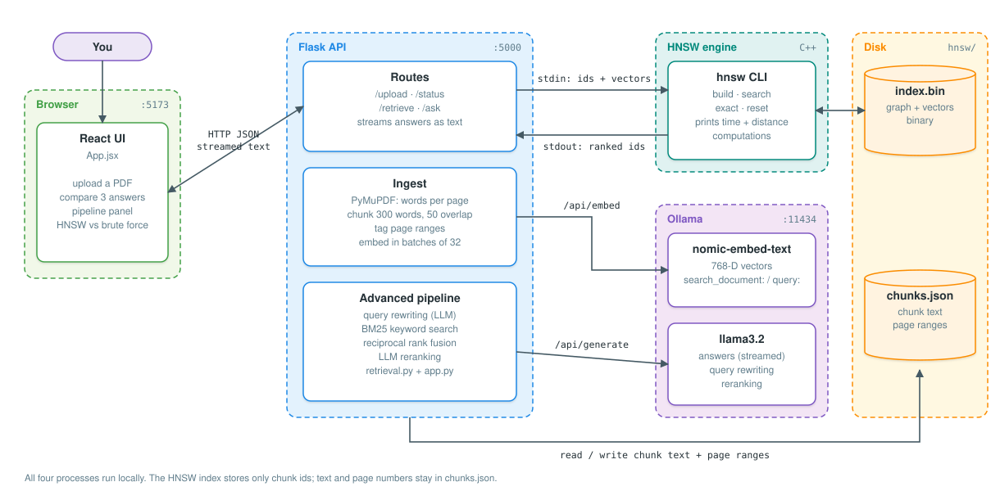
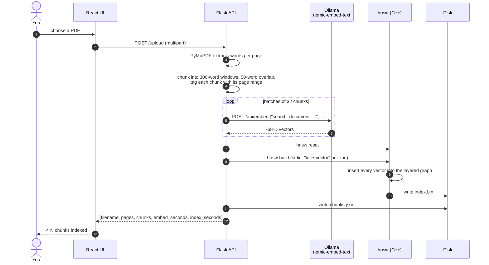
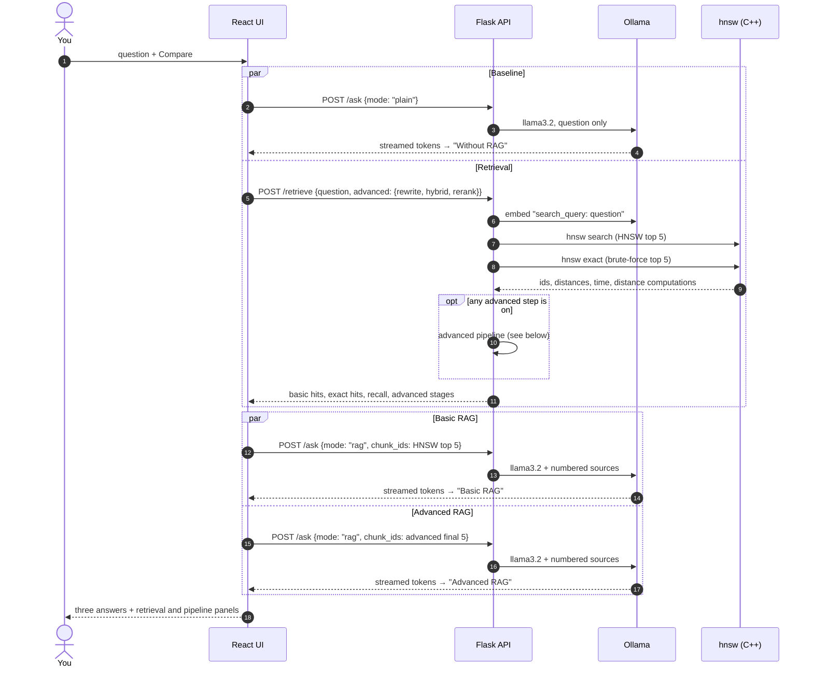
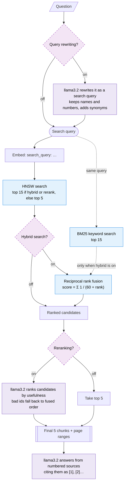
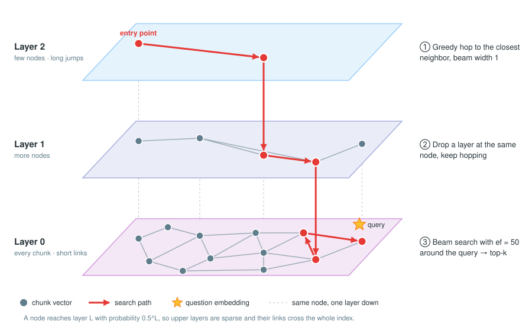
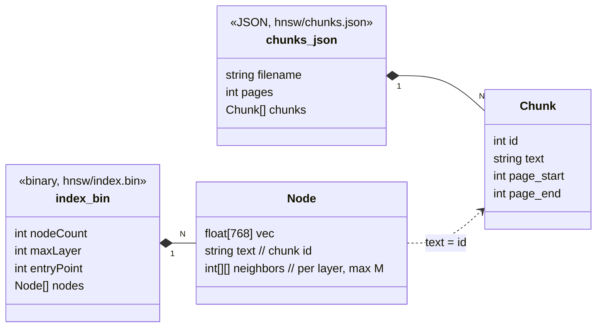

# Local Document Q&A Engine

> Ask questions about any PDF — fully local, zero data leaves your machine.
> Every question is answered three ways (no RAG, basic RAG, advanced RAG) so you can see what retrieval adds.

Built with a custom HNSW vector index in C++, Ollama for local LLM inference, Flask REST API, and a React frontend.

---

## Contents

- [What it does](#how-rag-works-here)
- [Architecture](#architecture)
- [Data flow](#data-flow): [indexing](#1-indexing-a-pdf), [asking](#2-asking-a-question-compare), [advanced pipeline](#3-advanced-retrieval-pipeline)
- [How HNSW search works](#how-hnsw-search-works)
- [Data model](#data-model) and [API](#api)
- [Setup](#setup)

---

## How RAG Works Here

1. PDF is split into overlapping 300-word chunks
2. Each chunk is embedded into a 768D vector using `nomic-embed-text`
3. Vectors are inserted into the HNSW index
4. At query time, the question is embedded and HNSW finds the 5 closest chunks
5. Those chunks become numbered sources for `llama3.2`, which streams an answer citing them
6. In parallel, the same model answers the same question with no document, as the baseline

The model never sees the full document — only the most relevant chunks. This keeps answers accurate and fast.

## RAG vs no RAG

Click **Compare** and the page shows:

- **Without RAG**: llama3.2 on its own. For anything specific to your PDF it will guess or refuse.
- **Basic RAG**: llama3.2 given the top 5 HNSW chunks, citing them as [1], [2]...
- **Advanced RAG**: the same model after query rewriting, hybrid search and reranking, each with its own switch
- **Pipeline panel**: what each advanced step retrieved and which chunks differ from basic RAG
- **Retrieval panel**: the chunks used, with page numbers and similarity, plus HNSW vs brute-force search time,
  distance computations, and how many of HNSW's results match the exact top 5

Ask questions only your document can answer (names, numbers, definitions) to see the difference most clearly.

---

## Architecture

Everything runs on your machine as four local processes. Nothing is sent to a cloud service.

<p align="center">
  
</p>

| Component | Tech | Responsibility |
|---|---|---|
| React UI | React 19, Vite | Upload a PDF, ask a question, stream three answers, show retrieval stats |
| Flask API | Python, Flask, PyMuPDF | Extract and chunk text, call Ollama, drive the HNSW binary, run the advanced pipeline |
| HNSW engine | C++17, from scratch | Approximate nearest-neighbor search over chunk vectors, plus exact search for comparison |
| Ollama | nomic-embed-text, llama3.2 | Turn text into vectors, generate answers, rewrite queries, rerank passages |
| Storage | `index.bin`, `chunks.json` | The graph and vectors (binary), and chunk text with page ranges (JSON) |

The HNSW index stores only chunk ids. Text and page numbers live in `chunks.json`, so non-ASCII text
never passes through command-line arguments.

---

## Data flow

### 1. Indexing a PDF



### 2. Asking a question (Compare)

One click starts three answers. The no-RAG baseline starts at once; the two RAG answers start when retrieval finishes.



### 3. Advanced retrieval pipeline

Each dashed box is a switch in the UI. With all three off, advanced RAG is identical to basic RAG.



| Step | What it does | Why it helps |
|---|---|---|
| Query rewriting | llama3.2 turns the question into a search query with key terms and synonyms | Conversational questions ("what did they decide?") embed poorly |
| Hybrid search | BM25 keyword search runs next to HNSW; results are merged with reciprocal rank fusion | Embeddings blur exact terms like names, codes and numbers; keywords catch them |
| Reranking | llama3.2 reorders the top 15 candidates by usefulness and keeps 5 | Similar text isn't always useful text; the LLM can judge which passage answers the question |

---

## How HNSW search works

HNSW (Hierarchical Navigable Small World) is the vector search algorithm behind Pinecone, Weaviate and Qdrant.
Instead of comparing the query with every stored vector, it walks a layered graph: sparse upper layers make
long jumps, the dense bottom layer refines.

<p align="center">
  
</p>

**Insert.** A new vector draws a random top layer (each layer up is half as likely). It descends greedily
from the entry point to that layer, then on each layer below it links to its `M` = 16 nearest nodes found by a
beam search. Links are two-way; when a node goes over `M` links it keeps its 16 closest.

**Search.** Greedy descent through the upper layers with a beam of 1, then a beam search of width `ef` = 50 on
layer 0, returning the best `k`.

**Why it matters here.** The app runs both HNSW and brute force on every question and shows the time, the number
of distance computations and how many results match. On one small PDF brute force is just as fast; the gap
appears with thousands of chunks. In a test with 10,000 clustered 768-D vectors, HNSW answered in about 0.4 ms
against 5.9 ms for brute force (about 14x), with 93% of the exact top 5.

The implementation in `hnsw/hnsw.cpp` covers cosine distance, random layer assignment, greedy and beam search,
neighbor trimming, exact search for ground truth, and binary save/load to `index.bin`.

---

## Data model



## API

| Method | Path | Body | Returns |
|---|---|---|---|
| `POST` | `/upload` | multipart `file` (PDF, max 50 MB) | `{filename, pages, chunks, embed_seconds, index_seconds}` |
| `GET` | `/status` | | `{indexed, filename, pages, chunks}` for the indexed document |
| `POST` | `/retrieve` | `{question, k?, advanced?: {rewrite, hybrid, rerank}}` | HNSW and exact hits with pages and scores, `recall`, timings, and every advanced stage |
| `POST` | `/ask` | `{question, mode: "plain" \| "rag", chunk_ids?}` | Streamed plain text answer |
| `GET` | `/health` | | `{status: "ok"}` |

---

---

## Setup

### Prerequisites
- [Ollama](https://ollama.com) installed and running
- Python 3.10+
- Node.js 18+
- g++ (MinGW on Windows)

### 1. Pull Ollama models
```bash
ollama pull nomic-embed-text
ollama pull llama3.2
```

### 2. Compile the HNSW engine (output must sit in `hnsw/`)
```bash
cd hnsw
g++ -O2 -o hnsw.exe hnsw.cpp   # Windows
# g++ -O2 -o hnsw hnsw.cpp     # Linux/Mac
```

### 3. Backend
```bash
cd backend
pip install -r requirements.txt
python app.py
```

Optional environment variables: `OLLAMA_URL`, `EMBED_MODEL`, `LLM_MODEL`, `HNSW_EXE`, `FLASK_DEBUG=1`.
The frontend reads `VITE_API_URL` (default `http://127.0.0.1:5000`).

### 4. Frontend
```bash
cd frontend
npm install
npm run dev
```

Open `http://localhost:5173`, upload a PDF, start asking questions.

---

## Project Structure
```
rag-engine/
├── hnsw/
│   ├── hnsw.cpp          # HNSW vector index (C++, from scratch)
│   ├── hnsw.exe          # compiled binary (not committed)
│   ├── index.bin         # HNSW graph + vectors (generated)
│   └── chunks.json       # chunk text and page numbers (generated)
├── backend/
│   ├── app.py            # Flask API + advanced pipeline (rewrite, rerank)
│   ├── retrieval.py      # BM25 keyword search and rank fusion
│   └── requirements.txt
├── frontend/
│   ├── src/
│   │   └── App.jsx       # React UI
│   ├── index.html
│   └── package.json
├── .gitignore
└── README.md
```

---

## Key Parameters

| Parameter | Value | What it controls |
|---|---|---|
| `M` | 16 | Max neighbors per node per layer — higher = more accurate, more memory |
| `ef` | 50 | Search beam width — higher = more accurate, slower |
| Chunk size | 300 words | Larger = more context per chunk, less precise retrieval |
| Overlap | 50 words | Prevents information loss at chunk boundaries |

---

## Author

**Arnav Sharma**  
B.Tech ECE, BMS College of Engineering  
[github.com/Arnavsharma2005](https://github.com/Arnavsharma2005)

